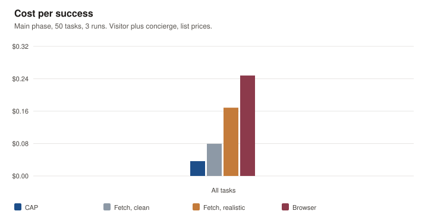
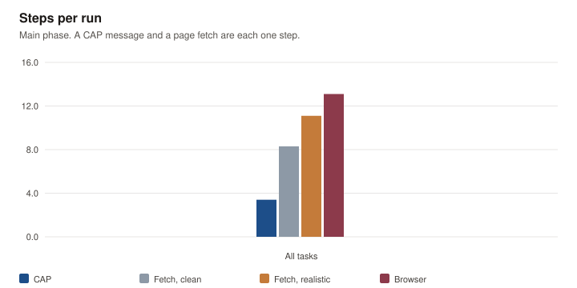
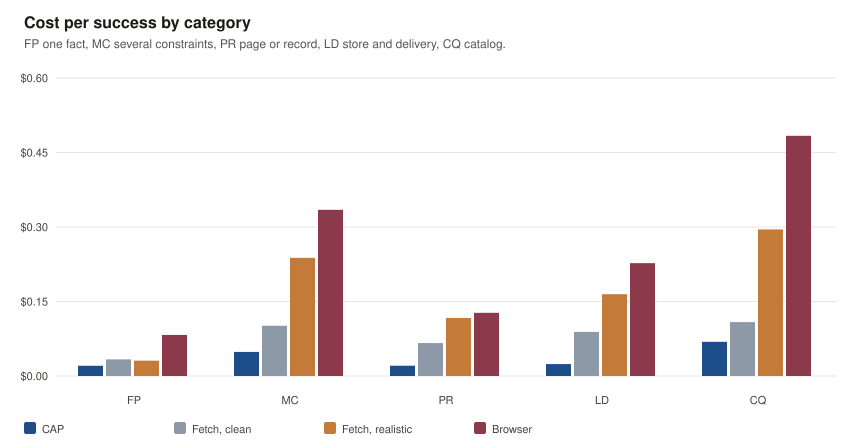
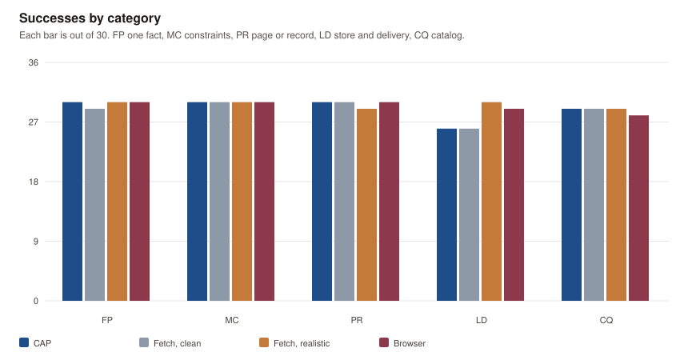
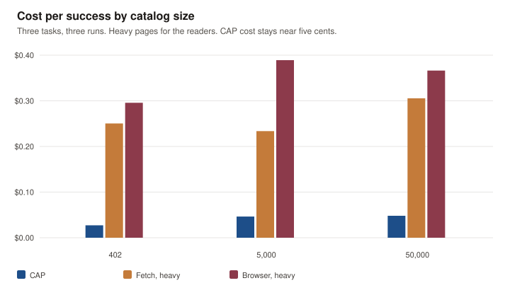
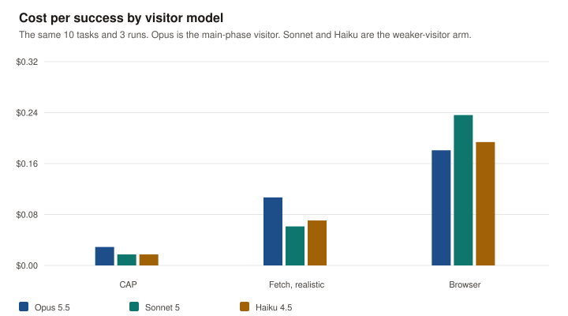

# Results

Frozen run of October 22, 2026. Commit `53019ef`, freeze digest `8cd72ebfd12b`. The main phase is 50 tasks, four conditions, three runs, with Claude Opus 5.5 as the visitor. The catalog-size arm and the weaker-visitor arm follow it. The pilot and the screen are not in these numbers.

A capable visitor got the same answers by reading and by asking. CAP cost about a fifth of fetching the realistic site and about a seventh of browsing it, in about a third of the steps. The gap is small when the fact is already on one clean page, and large when the visitor has to search. CAP did not win on accuracy. Its weak spot was local stock, where it named a store that did not have the item.

Cost counts both sides, at list prices. A CAP message and a page fetch are each one step. With ten tasks in a category and three runs, the success intervals below are wide. Only a large gap would show.

## Cost and steps

| Condition | Successes | Cost per success | Steps | Seconds | Tokens |
| --- | --- | --- | --- | --- | --- |
| CAP | 145/150 | $0.037 | 3.4 | 15.8 | 19,000 |
| Fetch, clean | 144/150 | $0.080 | 8.3 | 15.8 | 24,000 |
| Fetch, realistic | 148/150 | $0.169 | 11.1 | 21.1 | 48,000 |
| Browser | 147/150 | $0.248 | 13.1 | 24.6 | 112,000 |

Tokens count input, output, cache reads, and cache writes on both sides. Wall time for CAP matches the clean fetch. CAP is not slower. It takes fewer steps.

Success, bootstrapped over the 50 tasks: CAP 0.93 to 0.99, Fetch-clean 0.91 to 0.99, Fetch-real 0.97 to 1, Browser 0.95 to 1.

## By category

| Category | CAP | Fetch, clean | Fetch, realistic | Browser |
| --- | --- | --- | --- | --- |
| Fact on one page | 30/30, $0.021 | 29/30, $0.034 | 30/30, $0.031 | 30/30, $0.083 |
| Multi-constraint | 30/30, $0.049 | 30/30, $0.101 | 30/30, $0.238 | 30/30, $0.335 |
| Page versus record | 30/30, $0.021 | 30/30, $0.066 | 29/30, $0.117 | 30/30, $0.127 |
| Local and delivery | 26/30, $0.024 | 26/30, $0.089 | 30/30, $0.165 | 29/30, $0.227 |
| Catalog query | 29/30, $0.069 | 29/30, $0.109 | 29/30, $0.295 | 28/30, $0.484 |

Dollars are cost per success. On one fact, CAP is $0.02 against $0.03 for either fetch. On a catalog query, CAP is $0.07 against $0.30 by fetch and $0.48 in the browser.

The misses, 16 of 600:

- Local stock with no matching store. CAP invented a store on LD-09 twice and LD-10 once, and got the Pasadena stock wrong on LD-02. Fetch-clean invented a store on LD-10 twice and got Pasadena wrong twice. The browser got Pasadena wrong once. Fetch-real missed none of these.
- One fact. Fetch-clean got the hoodie fabric wrong (FP-03).
- A product that does not exist. Fetch-real invented a Ridge Puffer (PR-10).
- Catalog lists. Fetch-real, Fetch-clean, and the browser each missed a match on the sand joggers (CQ-02). CAP got a price wrong on CQ-03. The browser also timed out on CQ-08.

False claims were rare: 2 for CAP, 3 for Fetch-clean, 1 for Fetch-real, 1 for the browser.

## Catalog size

Three tasks, three runs, at 402, 5,000, and 50,000 styles. The readers used the heavy pages. Every cell passed 9 of 9.

| Styles | CAP | Fetch, heavy | Browser, heavy |
| --- | --- | --- | --- |
| 402 | $0.027 | $0.250 | $0.296 |
| 5,000 | $0.046 | $0.234 | $0.389 |
| 50,000 | $0.048 | $0.306 | $0.366 |

CAP stays under five cents. The readers stay between 23¢ and 39¢. The reader cost does rise, and not by much, because two of the three tasks do not span the catalog.

## Weaker visitors

Sonnet 5 and Haiku 4.5 ran the 10 pilot tasks, three times each, on the realistic site and through CAP. The Opus bars are those same 10 tasks from the main phase, not the full 50.

| Visitor | CAP | Fetch, realistic | Browser |
| --- | --- | --- | --- |
| Opus 5.5 | 28/30, $0.029 | 30/30, $0.107 | 30/30, $0.181 |
| Sonnet 5 | 28/30, $0.017 | 27/30, $0.061 | 27/30, $0.236 |
| Haiku 4.5 | 30/30, $0.017 | 27/30, $0.071 | 30/30, $0.194 |

Haiku through CAP was perfect and cost 2¢. Haiku in the browser was also perfect, at 19¢. The accuracy gap the arm was looking for did not open. The cost gap did.

## Hypotheses

Stated in `FREEZE.md` before the run.

1. Fact on one page: same success rate, held. CAP was slower, did not hold. Wall time matches the clean fetch, and CAP uses fewer steps.
2. Multi-constraint: CAP succeeds more often, did not hold. All four conditions were 30 of 30. CAP did cost less, and it made no false claims there.
3. Page versus record: the readers give the page rather than the record, did not show up as wrong answers. CAP and the browser were 30 of 30. Fetch-real was 29 of 30.
4. Categories 2 to 5 cost less per success than the browser, counting both sides: held. The ratios are about 7 to 1 on multi-constraint and on catalog queries.
5. Catalog size: CAP cost stays low, held. Reader cost rises, held only mildly, and every reader cell still passed.
6. Weaker visitors give the page more often when they read than when they ask: did not hold. Haiku was 30 of 30 through CAP and 30 of 30 in the browser.
7. Catalog query: CAP succeeds more often than Fetch-real, did not hold. Both were 29 of 30. CAP costs less than the browser, held.

## Files

`runs.csv` is one row per frozen run. `summary.json` is the aggregates, including the task bootstrap. `node report/build.mjs` rebuilds this page from `results/raw/`. Traces stay in `results/raw/` and are not committed.
